### Requisits de l'entorn de treball

- **Sistema operatiu:** màquina virtual amb **Zorin OS** (o distribució Linux equivalent).
- **Configuració de xarxa:**
  - **Interfície 1 (`eth0`/`enp0s3`):** mode **NAT** (per tenir sortida a Internet).
  - **Interfície 2 (`eth1`/`enp0s8`):** mode **Adaptador pont (Bridged)** amb la IP estàtica i els paràmetres assignats pel vostre responsable tècnic.
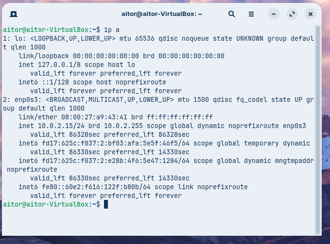

### Part A. Diagnosi avançada amb `dig` (Linux/macOS)

Executeu les comandes indicades a la consola de Linux i analitzeu els resultats obtinguts. Per mantenir les consultes relacionades, utilitzeu `tecnocampus.cat` per als registres A, NS i SOA. A la consulta inversa, substituïu el marcador per una de les adreces IP que us hagi retornat la primera comanda.

#### Comanda 1: consulta bàsica de registre A

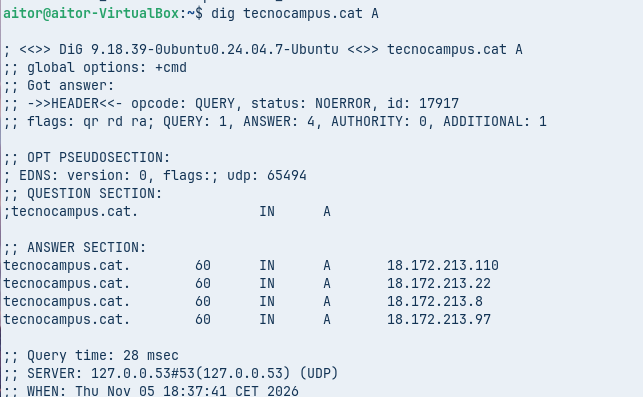
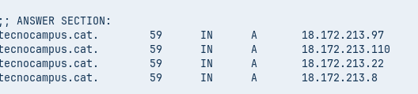
```bash
dig tecnocampus.cat A
```

- **Anàlisi requerida:** Identifiqueu la IP de resposta, el valor del TTL i l'adreça del servidor DNS que ha respost a la consulta.

#### Comanda 2: consulta de servidors de noms (NS)

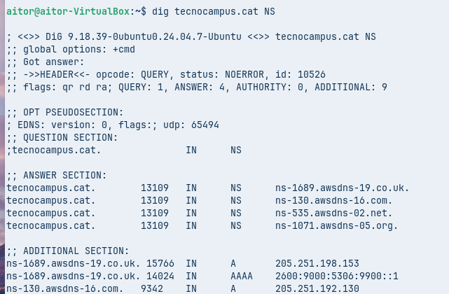
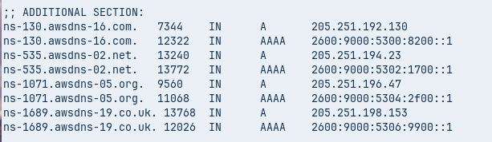

```bash
dig tecnocampus.cat NS
```

- **Anàlisi requerida:** Quins són els servidors de noms (*Name Servers*) autoritatius per a aquest domini?

#### Comanda 3: consulta detallada SOA

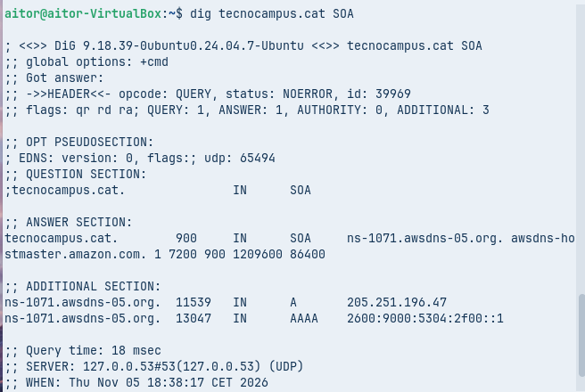

```bash
dig tecnocampus.cat SOA
```

- **Anàlisi requerida:** Quina és la informació del correu de l'administrador (`rname`) i quin és el número de sèrie (`serial`) del domini?

#### Comanda 4: consulta de resolució inversa

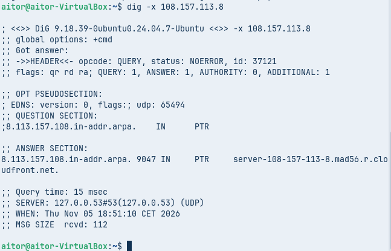

```bash
dig -x 108.157.11.8
```

- **Anàlisi requerida:** Quina informació sobre els registres `PTR` s'obté i a quin nom de domini correspon aquesta IP?
**El registre DNS PTR (Pointer Record) permet fer una consulta DNS inversa, és a dir, obtenir el nom de domini associat a una adreça IP.**

### Part B. Comprovació de resolució amb `nslookup` (mode interactiu amb Windows o Linux)

Exploreu l'ús de l'eina `nslookup` en mode interactiu executant la comanda `nslookup` sense arguments des de la terminal fins a veure el prompt (`>`).

**Comandes clau del mode interactiu:**

- `set type=TIPO`: Defineix el tipus de registre a consultar (`A`, `AAAA`, `MX`, `NS`, `SOA`, `TXT` o `ALL`).
- `server IP_o_NOM`: Canvia el servidor DNS al qual es realitzarà la consulta.
- `exit`: Surt del mode interactiu.


#### Comanda 5: consulta bàsica no autoritativa

1. Dins del prompt de `nslookup`, configureu: `set type=A`.
2. Escriviu el domini de consulta: `tecnocampus.cat`.

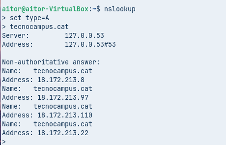

- **Anàlisi requerida:** Quina resposta dona la consola? 
**La consola mostra que, en fer una consulta DNS amb nslookup sobre el domini tecnocampus.cat, s'obtenen quatre adreces IPv4:**
- 18.172.213.8
- 18.172.213.97
- 18.172.213.10
- 18.172.213.22  

- Per què indica textualment que la resposta és **no autoritativa** (*Non-authoritative answer*)?
**La resposta apareix com a Non-authoritative answer perquè el servidor DNS consultat no és l'autoritat directa del domini tecnocampus.cat.**

#### Comanda 6: consultes autoritatives directes

1. Canvieu el servidor de consultes escrivint `server IP`, on la IP sigui la del primer servidor de noms autoritatiu obtingut a la comanda 2 per al domini `tecnocampus.cat` (per exemple, `server a9-66.akam.net` o la seva IP corresponent).

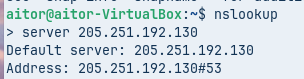

2. A continuació, configureu `set type=A` i consulteu de nou el domini `tecnocampus.cat`.

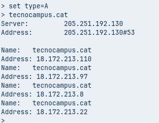

- **Anàlisi requerida:** Quines diferències s'observen en la resposta obtinguda respecte a la comanda 5? Comproveu si l'indicador "no autoritatiu" ha desaparegut.

### Part C. Resolucions locals i protocol mDNS

Comproveu el funcionament de la resolució local sense servidor DNS dedicat (útil per a xarxes locals petites):

1. Verifiqueu el nom d'equip (*hostname*) de la vostra màquina Zorin OS.
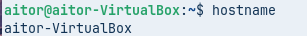
2. Des d'un altre equip de la mateixa xarxa local (o xarxa bridged), executeu la resolució local mitjançant el domini `.local`:

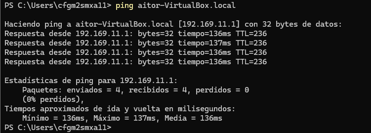

```bash
ping aitor-VirtualBox.local
```

- **Anàlisi requerida:** Descriviu com funciona el protocol **mDNS** (*Multicast DNS*), quin port utilitza (UDP 5353) i quin avantatge aporta en entorns on no es disposa d'un servidor DNS configurat.


## Fonts 
### Guio

Notebook:
https://notebook.google.com/notebook/2567c814-9cf4-4dc1-96b0-5137d8899908

### Comandes
Chatgpt:
https://chatgpt.com/share/6aecf8f1-d1d4-83ed-9414-28995bc390cc

### Mapa conceptual
Chatgpt:
https://chatgpt.com/share/6aecf9a3-fc6c-83eb-bc0b-3378d6c424e5